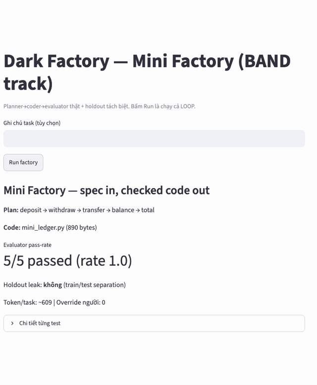

# Dark Factory — Mini Factory pocketful (BAND track)

 [](https://github.com/pham-canh/dark-factory/actions/workflows/ci.yml) 

Event: https://lablab.ai/ai-hackathons/wearedevelopers-hackathon | Track: pocketful | Demo: bản quay bên dưới (bản deploy cũ `dark-factory.streamlit.app` đã bị Streamlit Cloud gỡ)

<p align="center">
  
  <br>
  <a href="docs/demo.mp4">▶ Play the 5-second capture (silent, no narration)</a>
</p>

> Software factory kiểm chứng ví tiền: spec 1 trang → code → evaluator độc lập chấm conservation — cho solo dev ship tính năng tiền bạc không cần đọc từng diff. 5/5 holdout, ~609 tokens/task.

## Demo

- [`docs/demo.mp4`](docs/demo.mp4) — 5,4 giây, quay từ `app_streamlit.py` chạy local, không cần key. Bấm **Run factory** một lần, planner sinh `mini_ledger.py`, evaluator chấm `5/5 passed (rate 1.0)`, holdout leak `không`.
- Bản deploy trên Streamlit Cloud đã bị gỡ, nên link cũ không còn mở được. Chạy local bằng lệnh dưới đây để xem đúng thứ đó.

## Chạy (5 phút, không hỏi thêm)

```bash
python3 src/main.py
PYTEST_DISABLE_PLUGIN_AUTOLOAD=1 python3 -m pytest src/ -q
```

Xem đúng giao diện như video (không cần key):

```bash
pip install -r requirements.txt
streamlit run app_streamlit.py
```

## Architecture (factory thật, BAND load-bearing)

```
SPEC.md -> planner -> coder -> mini_ledger.py -> evaluator (holdout riêng) -> report
   |            BAND room 4ec606f4 (architect/coder/tester + human approve gate)
   |-> app_streamlit.py (demo public) |-> src/test_smoke.py (CI)
```

- `src/factory.py` — planner/coder/evaluator tách biệt (coder không đọc holdout)
- `src/holdout.json` — 5 scenarios conservation/no-double-spend (evaluator giữ riêng)
- `band-agents/` — 3 agents OpenCode nối BAND rooms thật (xem `BAND_EVIDENCE.md`)
- `BAND_EVIDENCE.md` — room ID + handoff + human APPROVE (gỡ BAND ra là mất LOOP)

## Results (pocketful track, chạy lại được bằng `python3 src/main.py`)

- Before: code ví viết tay ~2h + review diff thủ công -> After: factory spec→checked code ~1 phút + evaluator tự chấm
- Evaluator: 5/5 passed (rate 1.0) | Token/task: ~609 | Override: 0 (chưa review tay)
- Invariants chứng minh: conservation (deposit 100+50=150), transfer giữ tổng, double-spend raise, âm raise, balance mới = 0

## Cần key gì (nếu có)

- **Không cần key nào.** `plan()` / `code()` / `evaluate()` đều là hàm cục bộ, không gọi API. Chỉ khi mở rộng sang LLM thật mới cần key, và khi đó phải để qua biến môi trường (xem `.gitignore`).

## Cấu trúc (root đẩy GitHub, docs thi vào docs/lablab/)

- `src/main.py` — MVP entrypoint
- `src/test_smoke.py` — smoke test (CI chạy)
- `app.py`, `requirements.txt`, `Dockerfile` — deploy HF Spaces
- `docs/lablab/` — BRIEF/CONCEPT/JUDGE_REPORT/DEMO_SCRIPT/PITCH_SCRIPT/DECK (nộp giải, không nhiễu NTD)
- `DEMO_SCRIPT.md` — kịch bản quay 2 phút (bản thi)
